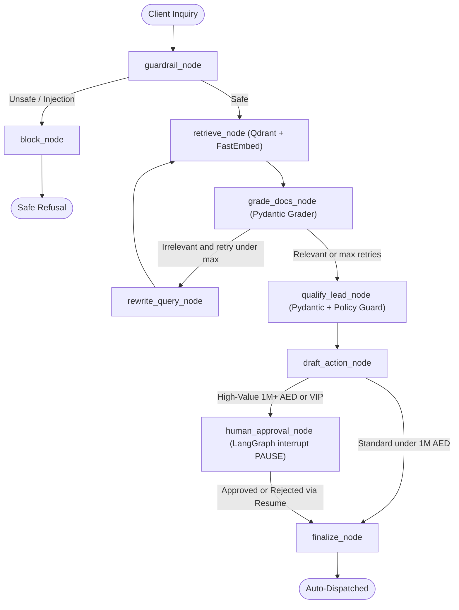

# SentinelOps — Autonomous Real Estate AI & HITL Governance Agent

**SentinelOps** is a production-oriented **LangGraph** multi-step agentic system built for **Dubai/UAE Real Estate Brokerages**. Unlike naive RAG chatbots that hallucinate answers or execute high-stakes commitments blindly, SentinelOps combines **Self-Corrective RAG**, **Deterministic Policy Guardrails**, **Pydantic Structured Qualification**, and **Persistent Human-in-the-Loop (HITL)** interrupts backed by SQLite checkpointing.

---

## Why SentinelOps?

Real estate inquiries in high-value markets like Dubai carry strict legal and financial stakes (DLD transfer fees, UAE Golden Visa thresholds, RERA Escrow rules, and AED 1M–25M+ property viewings). Standard LLM wrappers fail in production because they:
1. **Hallucinate** when vector search returns low-relevance context.
2. **Lack governance** to pause and request Senior Broker authorization before quoting or scheduling VIP deals.

SentinelOps solves both using a stateful cyclic **LangGraph `StateGraph`** workflow.

---

## System Architecture



---

## Core Engineering Highlights

- **Self-Corrective RAG (CRAG) Loop:** Retrieves top-k context from a local persistent **Qdrant** vector store (`FastEmbed` ONNX embeddings—zero PyTorch bloat or external embedding API cost). A structured `DocumentGrade` node evaluates relevance and dynamically rewrites poor queries up to `MAX_RAG_RETRIES` (circuit breaker prevents infinite loops).
- **Hybrid Deterministic Governance:** Uses `ChatGroq` (`with_structured_output`) to extract client `intent`, `estimated_budget_aed`, and `property_interest` into strict Pydantic schemas—enforced alongside deterministic Python policy checks (`>= 1,000,000 AED` or VIP viewing requests always trigger HITL).
- **Persistent Human-in-the-Loop (HITL):** High-value deals invoke LangGraph's `interrupt()` and persist graph state to **SQLite (`AsyncSqliteSaver`)**. Execution can survive server restarts or browser reloads and resume cleanly from the exact breakpoint using `Command(resume=...)`.
- **Prompt Injection Defense:** Fast deterministic guardrail node filters prompt-injection attempts before hitting retrieval or LLM inference.
- **Interactive Operations Console & REST API:** Built with **FastAPI** (managed via async `lifespan`) and a sleek dark-mode control desk displaying live node execution traces, Qdrant similarity scores, and Senior Broker approval controls.
- **Offline Automated Test Suite:** Full `pytest` suite with mocked LLM/retrieval verifying guardrails, retry circuit breakers, and SQLite HITL pause/approve/reject persistence in seconds at zero API cost.

---

## Tech Stack

| Layer | Technology |
|---|---|
| **Agent Orchestration** | LangGraph (`StateGraph`, `interrupt`, `Command`), Reducers |
| **State Persistence** | `langgraph-checkpoint-sqlite` (`AsyncSqliteSaver` / `aiosqlite`) |
| **LLM Inference** | Groq API (`langchain-groq`, `llama-3.3-70b-versatile`) |
| **Vector DB & Embeddings** | Qdrant (local persistent) + FastEmbed (`BAAI/bge-small-en-v1.5`) |
| **Backend API** | FastAPI, Uvicorn, Pydantic v2, `pydantic-settings` |
| **Frontend UI** | Single-page HTML / Tailwind CSS / Vanilla JS (XSS-safe rendering) |
| **Testing** | Pytest (unit + integration tests with offline LLM mocking) |

---

## Quick Start

### 1. Clone & Create Virtual Environment
```bash
git clone https://github.com/mominulislam14/sentinelops-agent.git
cd sentinelops-agent
python -m venv venv
```

Activate the environment:
- **Windows (PowerShell):** `.\venv\Scripts\Activate.ps1`
- **Linux / macOS:** `source venv/bin/activate`

### 2. Install Dependencies
```bash
pip install -r requirements.txt
```

### 3. Configure Environment
```bash
cp .env.example .env
```
Add your `GROQ_API_KEY` inside `.env`.

### 4. Run the Application
```bash
uvicorn app.main:app --port 8000
```
- **Visual Control Desk:** `http://127.0.0.1:8000`
- **Swagger API Docs:** `http://127.0.0.1:8000/docs`

### 5. Run Automated Tests (Offline / Zero API Cost)
```bash
python -m pytest -v
```

---

## API Endpoints

| Method | Endpoint | Description |
|---|---|---|
| `GET` | `/api/health` | Service health and active model metadata |
| `POST` | `/api/inquiry` | Submit a client inquiry (returns `completed` or `awaiting_approval`) |
| `POST` | `/api/approve` | Resume a paused HITL thread (`approved` / `rejected` + broker note) |
| `GET` | `/api/thread/{thread_id}` | Retrieve persisted thread state from SQLite |

---

## Author

**Mominul Islam** — AI Systems Engineer & Full-Stack Architect  
- LinkedIn: [linkedin.com/in/mominulislam14](https://www.linkedin.com/in/mominulislam14)
- GitHub: [github.com/mominulislam14](https://github.com/mominulislam14)
- Production SaaS: [oibayz.com](https://oibayz.com)